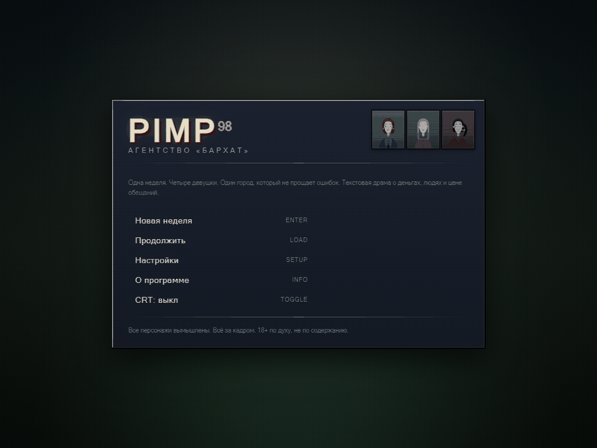
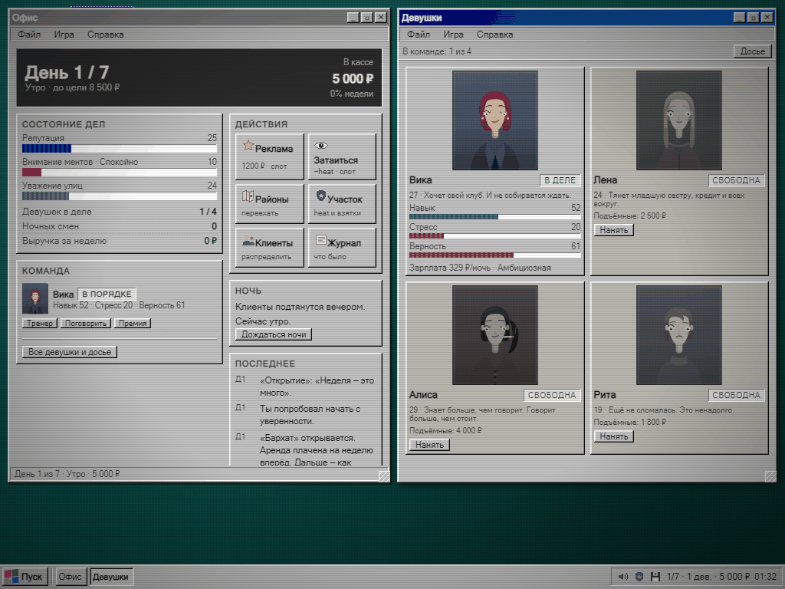
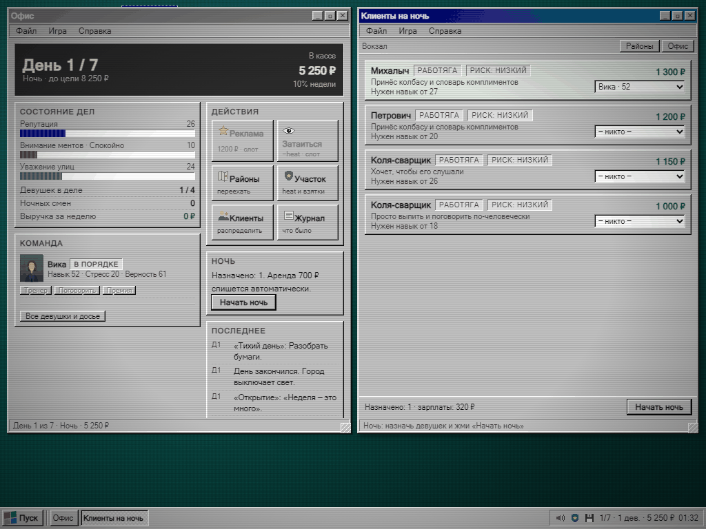
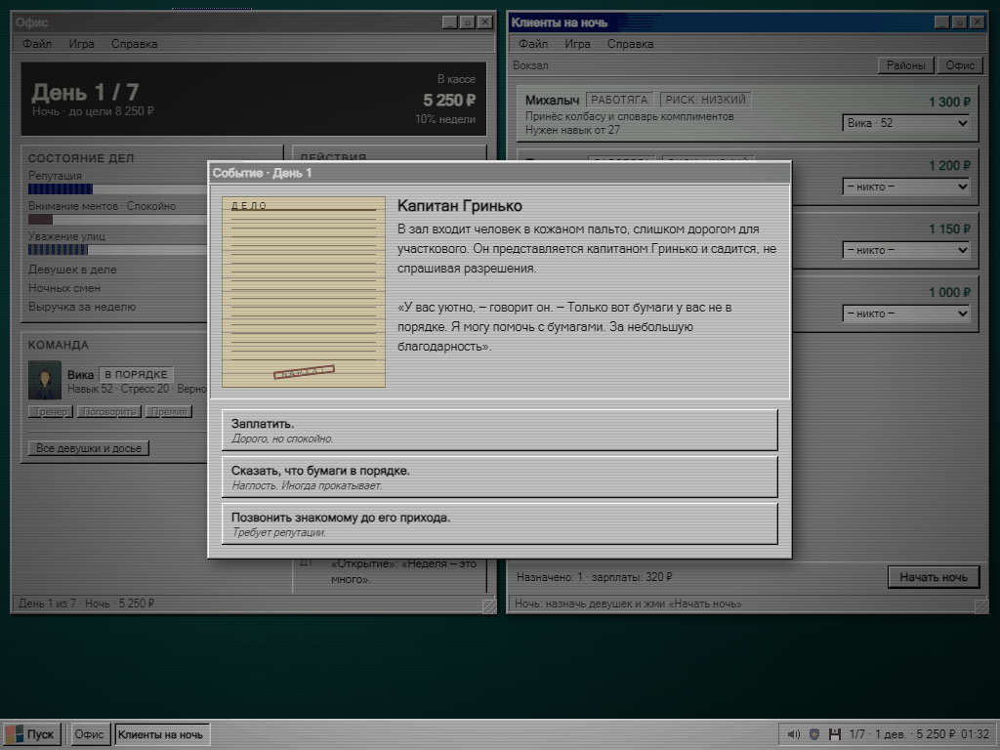
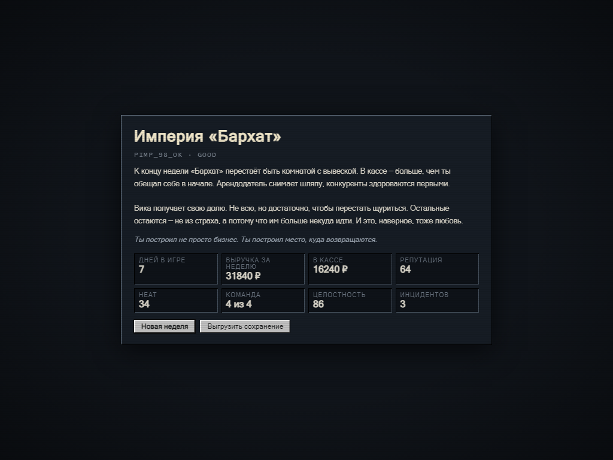

```
╔══════════════════════════════════════════════════════════════════╗
║                                                                  ║
║      ██████╗ ██╗███╗   ███╗██████╗      █████╗  █████╗            ║
║      ██╔══██╗██║████╗ ████║██╔══██╗    ██╔══██╗██╔══██╗           ║
║      ██████╔╝██║██╔████╔██║██████╔╝    ╚█████╔╝╚█████╔╝           ║
║      ██╔═══╝ ██║██║╚██╔╝██║██╔═══╝     ██╔══██╗██╔══██╗           ║
║      ██║     ██║██║ ╚═╝ ██║██║         ╚█████╔╝╚█████╔╝           ║
║      ╚═╝     ╚═╝╚═╝     ╚═╝╚═╝          ╚════╝  ╚════╝            ║
║                                                                  ║
║               А Г Е Н Т С Т В О  « Б А Р Х А Т »                  ║
║        одна неделя · четыре девушки · один город                 ║
╚══════════════════════════════════════════════════════════════════╝
```

# PIMP 98

**Нуар-сатира в оболочке Windows 98.** Текстовая менеджмент-драма о неделе из жизни маленького агентства в 1998 году: деньги, люди и цена обещаний.

Внутри — рабочий стол, перетаскиваемые окна, панель задач, меню «Пуск», загрузочный экран BIOS, синий экран смерти и CRT-развёртка. Снаружи — семь дней, чтобы собрать кассу, не сломать команду и не сесть самому.

> Всё за кадром. Игра про экономику, переговоры, доверие и последствия, а не про физиологию. Все персонажи совершеннолетние и вымышленные.



---

## Системные требования

| | |
|---|---|
| **Процессор** | Pentium 233 МГц или лучше |
| **Память** | 32 МБ ОЗУ |
| **Видео** | 800×600, 256 цветов |
| **Звук** | Sound Blaster 16 (необязательно) |
| **Браузер** | любой современный |
| **Мышь** | настоятельно рекомендуется |

Место на диске: около 40 КБ минифицированного кода. Порты не пробрасываются, дозвон не требуется.

---

## Запуск

```bash
npm install
npm run dev      # http://localhost:5173
npm run build    # прод-сборка в dist/
npm run test     # 60 тестов движка, сцен и баланса
npm run typecheck
```

Сборка полностью офлайн: ни одного внешнего запроса, ни одной скачанной картинки. Портреты, иконки и звуки генерируются кодом во время выполнения.

---

## Как играть

День делится на **утро / день / вечер / ночь**. Днём вы тратите слоты на дела. Ночью распределяете девушек по клиентам и получаете счёт.

| Действие | Что делает |
|---|---|
| Тренер | +навык, +стресс, −400 ₽ |
| Поговорить | +верность, +доверие, −стресс |
| Премия | +верность, −600 ₽ |
| Реклама | +репутация, +heat |
| Затаиться | −heat, −репутация |
| Переезд в район | другой уровень чеков и риска |

У каждой девушки свой навык, стресс, верность, доверие и сюжетная арка. Клиенты бывают шести типов: работяга, бизнесмен, мент, бандит, журналист, романтик. У каждого свой бюджет и свой скрытый риск.

**Цель:** за 7 дней собрать **13 500 ₽**, сохранить команду и не довести heat до 100. Кассу подъедают зарплаты и аренда — 700 ₽ каждую ночь, независимо от результата.

### Горячие клавиши

| Клавиша | Действие |
|---|---|
| `F1` | справка |
| `F5` | быстрое сохранение |
| `Esc` | закрыть активное окно |



---

## Ночь

Ночью на экране «Клиенты» появляется список заказов. Каждой девушке — один клиент. Шанс успеха зависит от навыка относительно требований клиента, верности и стресса. Риск зависит от района, типа клиента и вашего heat.

Плохая ночь — это не только ноль в кассе. Это подстава, недоплата, облава или статья в газете.



---

## События

Двадцать пять сюжетных карточек с последствиями: Вика хочет свой клуб, Лена копит на побег, Алиса пишет заметки в блокнот, Риту ищут люди из прошлого. Плюс менты, журналисты, люди с причала и конкурент через дорогу.

Каждый выбор меняет цифры. Иногда — не те, которые вы ожидали.



---

## Концовки

| Код | Название | Условие |
|---|---|---|
| `PIMP_98_OK` | Империя «Бархат» | деньги + целая команда + низкий heat |
| `PIMP_98_SOFT` | Бархатный сезон | деньги есть, но не империя |
| `PIMP_98_QUIET` | Тихо закрылись | дотянул, но не хватило |
| `PIMP_98_BROKE` | Минус на минус | касса в минусе |
| `PIMP_98_FATAL` | Дело № 1998 | heat 100 — арест |
| `PIMP_98_EMPTY` | Пустой зал | команда ушла |



---

## Что под капотом

- **Vite + TypeScript strict**, без фреймворка. Свой Win98-кит на CSS-переменных и `box-shadow`.
- **Чистое ядро без DOM** — состояние, RNG, экономика и сейвы тестируются и симулируются отдельно от интерфейса.
- **Детерминизм:** mulberry32 и сид строки. Один сид — одна неделя. `Math.random` в движке нет вообще.
- **Процедурные портреты:** SVG собирается из слоёв — череп, причёска, одежда, глаза, брови, рот, аксессуары. Сид влияет на наклон головы, посадку глаз и толщину бровей.
- **Звук:** WebAudio на квадратной волне. Ни одного файла.
- **Сейвы:** автосейв в `localStorage` после каждого действия, ручное сохранение, выгрузка и импорт JSON, версионирование схемы с миграцией.

### Проверено, а не на глаз

- `typecheck` — чисто, `build` — 38 КБ gzip, `test` — **60/60**.
- Полный прогон недели в headless Chrome: ночь, отчёт, события, переход дня, сейв, финал. Ошибок в консоли нет.
- Баланс откалиброван симуляцией по пяти сидам и пяти стратегиям: «ничего не делать» → `broke`, «пахать без управления» → `quiet`, «управлять командой» → `velvet`/`empire`.

### Структура

```
src/
  app/game.ts        контроллер: окна, события, ночь, финалы
  game/              чистое ядро без DOM: состояние, RNG, экономика, сейвы
  content/           девушки, клиенты, локации, события
  art/               процедурные SVG-портреты и пиксель-иконки
  ui/                Win98: окна, панель задач, диалоги, boot, BSOD
  scenes/            экраны игры
  styles/            токены, Win98-хром, раскладки
tests/               движок, сцены, симуляции баланса
tools/               headless-Chrome сценарии для скриншотов
docs/screenshots/    кадры для этого README
```

---

## Лицензия

[MIT](LICENSE) © 2026 Tony Flame

Персонажи, события и организация вымышлены. Совпадения с реальными людьми, местами и агентствами из 1998 года — случайны.

```
C:\> _
```
